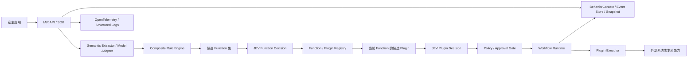
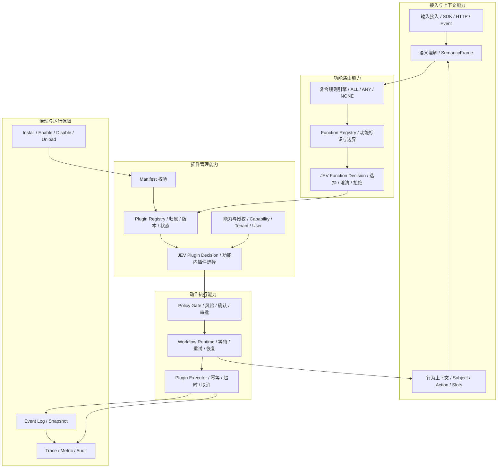
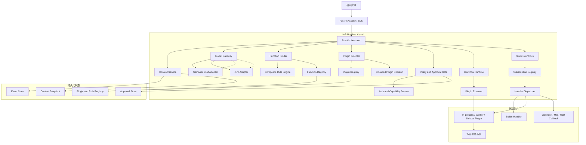

# Intent Action Runtime（IAR）

> 独立、可嵌入、可审计的意图动作运行时：把自然语言中的主语、意图、功能和动作，转换为受规则约束的插件执行。

**状态：方案设计**

## 1. 项目定位

IAR（Intent Action Runtime，意图动作运行时）是一个独立的功能插件运行时。它不负责建设某个具体业务系统，而是为宿主应用提供一套共通能力：

- 从多轮输入和结构化上下文中恢复主语、目标、动作和槽位；
- 先通过复合规则确定可进入的业务功能，再在功能边界内选择插件；
- 通过策略、授权、确认和工作流控制副作用；
- 在会话继续、重试、暂停、恢复和上下文压缩后保持行为状态一致；
- 用插件 Manifest 描述功能归属、输入契约、能力和生命周期。

IAR 可以作为宿主应用内的 SDK、独立 Sidecar 或服务部署。它不要求宿主采用某个模型供应商，也不要求宿主使用某个 Agent 框架。

## 2. 目标与非目标

### 2.1 目标

1. 用统一契约表达 `Function`、`Plugin`、`Rule`、`Workflow`、`Action`、`Decision` 和 `BehaviorContext`。
2. 将“功能路由”和“功能内插件选择”分开，避免模型从所有插件中无边界选择。
3. 允许通用大模型负责开放式语义抽取和回复生成，允许 JEV 只负责结构化选择、评分和拒绝决策。
4. 通过事件日志、上下文投影和压缩校验保留执行所需的主语、动作、槽位和工作流状态。
5. 支持可信插件先进程运行，并为不可信插件提供 Worker、Sidecar 或容器化执行路径。
6. 通过 JSON Schema 固化宿主、插件、模型工具调用和持久化数据之间的边界。

### 2.2 非目标

- 不建设聊天产品、知识库、工单系统或人工服务系统本身；这些属于 IAR 可以路由到的功能插件。
- 不用 JEV 生成自然语言、长文本摘要或最终解释；JEV 是类型化决策提供方。
- 不允许所有插件直接暴露给模型进行无约束选择。
- MVP 不强制引入消息队列、向量数据库或分布式工作流平台。

## 3. 架构视图

### 3.1 总体架构图



### 3.2 功能架构图

功能架构图按 IAR 的能力边界分层，说明每类功能负责什么，不表示具体进程部署位置。



### 3.3 逻辑架构图

逻辑架构图描述一次行为运行在 Node.js 进程中的组件协作，以及哪些状态必须落盘。模型调用统一经过 `ModelGateway`，插件调用统一经过 `PluginExecutor`，两者都不能绕过运行时策略。



### 3.4 路由与执行主链路

架构核心是“候选集由规则产生，最终选择由受限决策完成，副作用由运行时执行”：

```text
用户输入 / 宿主事件
  -> SemanticFrame
  -> 复合规则生成候选 Function
  -> JEV 选择 Function 或 needs_clarification
  -> 只加载该 Function 已授权的 Plugin
  -> JEV 选择 Plugin 或 unknown
  -> 策略 / 权限 / 确认
  -> Workflow 执行 Action
  -> 事件日志 + BehaviorContext 投影
```

## 4. 核心领域模型

### 4.1 Function：业务功能边界

`functionId` 表示用户想完成的业务功能，例如 `knowledge.query`、`ticket.create`、`human.transfer` 或宿主自定义的 `dip.service.stop`。Function 负责定义：

- 允许的意图和动作；
- 必需槽位和目标实体类型；
- 可以承载哪些插件；
- 所需能力、审批级别和风险等级；
- 功能级路由规则。

Function 是授权和路由的第一层边界。

### 4.2 Plugin：功能的具体实现

`pluginId` 表示一个可安装、可启停、可版本固定的具体实现。插件必须归属一个 `functionId`，不能脱离功能边界被路由：

- `ticket.create` 可以有 `jira-ticket-v1`、`internal-ticket-v2` 等插件；
- `human.transfer` 可以有 `im-transfer`、`phone-transfer` 等插件；
- `dip.service.stop` 可以有 `dip-api-stop-v1`、`ops-approval-stop-v2` 等插件。

插件 Manifest 描述输入输出 Schema、能力声明、生命周期钩子、健康检查和执行入口。

### 4.3 Rule：候选集生成器

`ruleId` 表示可版本化的复合规则。规则不直接执行副作用，而是根据 `SemanticFrame`、上下文、宿主租户和策略生成：

- 候选 Function；
- 必须满足的槽位；
- 风险标签；
- 需要澄清或需要确认的原因；
- 规则版本和命中证据。

规则可以组合关键词、实体类型、动作类型、状态、权限、来源和历史上下文。规则结果必须可解释、可记录、可重放。

### 4.4 Workflow：动作状态机

`workflowId` 表示一次可暂停、可重试、可恢复的动作编排。它负责等待槽位、等待确认、调用插件、处理重试、记录外部结果和收敛终态。Workflow 不重新解释用户意图，也不绕过 Function 和 Policy。

### 4.5 Decision：类型化决策

IAR 将模型决策与文本生成分离：

| 决策类型 | 负责内容 | 推荐实现 |
| --- | --- | --- |
| `semantic.extract` | 从输入和上下文抽取主语、动作、实体、槽位和候选意图 | 通用大模型适配器 |
| `function.select` | 在规则给出的候选 Function 中选择一个、拒绝或要求澄清 | JEV Adapter |
| `plugin.select` | 在当前 Function 已授权的候选 Plugin 中选择一个或拒绝 | JEV Adapter |
| `policy.evaluate` | 评估风险、权限、确认和审批条件 | 规则/策略引擎，必要时 JEV |
| `response.generate` | 生成面向用户或宿主的自然语言结果 | 通用大模型适配器或宿主 |

JEV 只接收有限候选和结构化输入，输出 `choice`、`score` 或 `noul` 等可校验结果。IAR 负责阈值、回退、审计和副作用，不把 JEV 的输出直接当成执行授权。

## 5. 两阶段功能路由

### 5.0 Function 规则与 Plugin 规则

规则分为两级，不能混用：

| 规则类型 | 负责对象 | 输入 | 输出 | 是否能直接执行插件 |
| --- | --- | --- | --- | --- |
| `FunctionRule` | 功能边界 | `SemanticFrame`、`BehaviorContext`、用户/租户和环境 | 候选 `functionId`、命中证据、必需槽位、风险标签 | 否 |
| `PluginRule` | 功能内实现 | 已选 `functionId`、槽位、能力、环境和插件状态 | 候选 `pluginId`、过滤原因、约束和优先级 | 否 |

Function 规则先执行，决定“这是查知识、提工单、转人工还是停止服务”。只有 Function 决策成功后，Plugin 规则才允许在该 Function 的已启用、已授权插件中筛选实现。Plugin 规则不能直接把请求路由到另一个 Function。

两类规则都使用同一套复合条件：

- `ALL`：所有子条件都满足；
- `ANY`：任一子条件满足；
- `NONE`：所有子条件都不满足，用于排除误路由。

规则执行顺序固定为：

```text
结构化字段校验
  -> FunctionRule ALL / ANY / NONE
  -> 生成有限 Function 候选集
  -> JEV Function Decision
  -> PluginRule ALL / ANY / NONE
  -> 能力 / 租户 / 环境 / 状态过滤
  -> 生成有限 Plugin 候选集
  -> JEV Plugin Decision
```

规则冲突时不静默覆盖：先比较优先级和特异性；仍无法区分时进入 `needs_clarification`，规则命中证据、版本和排除原因全部写入决策事件。可复制的规则配置见 [`references/路由规则示例.yaml`](./references/路由规则示例.yaml)。

### 5.1 第一阶段：确定 Function

输入可以是当前用户文本，也可以是宿主传入的结构化事件。Semantic Extractor 先生成 `SemanticFrame`：

```json
{
  "subject": {"type": "dip.service", "id": "test1", "source": "context"},
  "intent": "service.stop",
  "action": "stop",
  "slots": {"serviceId": "test1"},
  "references": [{"text": "第一个服务", "resolvedTo": "test1"}],
  "confidence": 0.96
}
```

复合规则读取 `SemanticFrame` 和 `BehaviorContext`，生成候选功能。例如“停止第一个服务”会沿用上一轮列表中的序号映射，将“第一个服务”解析为 `test1`，随后只产生 `dip.service.stop` 等相关候选。

JEV 的输入只能是候选 Function 及其结构化描述，返回：

```json
{
  "decisionType": "function.select",
  "choice": "dip.service.stop",
  "score": 0.98,
  "reasonCode": "intent_and_action_match",
  "decisionVersion": "function-router@1"
}
```

如果分数不满足阈值，或者候选之间不可区分，返回 `needs_clarification`，而不是猜测。

### 5.2 第二阶段：确定 Plugin

Function 确定后，Registry 只加载该 Function 的已启用、版本固定、能力允许的插件。系统把插件的名称、描述、输入 Schema、能力和限制提供给决策适配器，由 JEV 在封闭候选集中选择：

```json
{
  "decisionType": "plugin.select",
  "functionId": "dip.service.stop",
  "candidates": [
    {"pluginId": "dip-api-stop-v1", "description": "调用 DIP API 停止服务"},
    {"pluginId": "ops-approval-stop-v2", "description": "先发起审批，再执行停止"}
  ],
  "constraints": {"requiredCapabilities": ["dip.service.write"]}
}
```

插件选择后仍需经过 Policy Gate。模型只能提出选择，不能授予自己能力、修改参数约束或跳过确认。

### 5.3 三类常见路由

| 用户目标 | Function 示例 | 路由结果 |
| --- | --- | --- |
| 查询资料 | `knowledge.query` | 选择检索插件，再执行查询工作流 |
| 提交工单 | `ticket.create` | 解析标题、描述、优先级等槽位，选择工单插件，必要时确认 |
| 转人工 | `human.transfer` | 选择 IM、电话或人工队列插件，校验营业时间和权限 |

这三类只是验证 IAR 共通路由模型的示例，不属于 IAR 内置业务系统。

## 6. 插件模型与生命周期

### 6.1 插件注册

插件通过 Manifest 声明归属 Function、版本、能力、输入输出 Schema 和入口。安装时执行：

1. 解析 Manifest 并校验 JSON Schema/YAML 结构；
2. 校验 `functionId` 是否存在以及版本兼容性；
3. 校验能力是否需要新增授权；
4. 解析依赖并生成确定性加载顺序；
5. 注册 Rule、Workflow、Handler、HealthCheck 和事件订阅；
6. 写入插件版本、来源、摘要和授权记录。

### 6.2 生命周期

```text
discovered -> validated -> installed -> enabled -> running
                                      |          |
                                      v          v
                                   disabled <- draining
                                      |
                                      v
                                  uninstalled
```

插件挂载和卸载必须是可逆的：卸载只能移除注册表中的当前能力和监听器，不得删除历史事件。执行中的 Workflow 需要根据策略继续使用已固定版本，或进入 `plugin_unavailable` 等待状态。

### 6.3 Manifest 最小字段

```yaml
pluginId: dip-api-stop-v1
pluginKind: function
scope: function
functionId: dip.service.stop
version: 1.0.0
description: 调用 DIP API 停止指定服务
capabilities:
  - dip.service.write
inputSchema: ...
outputSchema: ...
entrypoint: ./dist/index.js
```

可复制的完整示例见 [`references/插件Manifest示例.yaml`](./references/插件Manifest示例.yaml)。

### 6.4 Hook、状态事件与订阅

这里明确区分四个概念：

| 概念 | 定义 | 由谁提供 |
| --- | --- | --- |
| `HookDefinition` | Runtime 定义的生命周期扩展点 | IAR Core |
| `StateEvent` | Runtime 状态变化通知 | IAR Core |
| `HookSubscription` | 用户或系统声明的订阅关系 | Subscription Registry |
| `Handler` | 收到 Hook/Event 后执行的动作 | 内置处理器、用户回调或 Plugin |

Plugin 不是 Hook。Plugin 可以提供 Handler，也可以注册订阅，但用户订阅的对象是 Hook/Event。

#### 6.4.1 内部 Hook

内部 Hook 用于运行时关键阶段，支持同步执行和阻断：

```text
semantic.extract.before
function.route.before
plugin.select.before
policy.evaluate.before
action.before
workflow.resume.before
context.compact.before
```

内部 Hook 可以返回 `allow`、`deny` 或经过 Schema 校验的 `patch`。例如权限处理器可以在 `action.before` 阶段返回 `deny`，日志处理器不能阻断业务动作。

#### 6.4.2 对外状态事件

状态事件用于用户订阅，默认异步通知，不参与主流程决策：

| StateEvent | 载荷重点 | 典型用途 |
| --- | --- | --- |
| `run.created` | `runId`、`conversationId`、来源 | 初始化 Trace、审计上下文 |
| `input.received` | 输入、来源、脱敏上下文 | 日志、限流、租户校验 |
| `semantic.extracted` | `SemanticFrame` | 记录语义抽取结果 |
| `function.selected` | `functionId`、决策版本、分数 | 路由审计、指标统计 |
| `plugin.selected` | `pluginId`、版本、决策版本 | 记录最终实现 |
| `policy.evaluated` | 权限、风险、确认结果 | 安全审计、告警 |
| `confirmation.required` / `confirmation.received` | 确认对象、上下文哈希 | 通知用户、确认审计 |
| `workflow.started` / `workflow.resumed` | Workflow 状态和步骤 | 流程监控 |
| `action.started` / `action.succeeded` / `action.failed` | 结果摘要、耗时、错误分类 | 日志、指标、告警 |
| `context.compacted` / `context.compaction_failed` | 摘要版本、校验结果 | 压缩审计和故障分析 |
| `workflow.completed` / `workflow.failed` | 最终状态和错误 | 生命周期收尾 |
| `run.completed` / `run.failed` | 最终运行结果 | 外部通知、归档 |

插件生命周期事件仍然由 Runtime 发布：`plugin.discovered`、`plugin.validated`、`plugin.installed`、`plugin.enabled`、`plugin.disabled`、`plugin.unloaded`。

### 6.5 订阅模型与调度契约

用户通过 `HookSubscription` 订阅事件：

```yaml
subscriptionId: notify-action-failed
event: action.failed
filter:
  functionId:
    in:
      - dip.service.stop
      - ticket.create
handler:
  type: webhook
  ref: ops-alert-webhook
delivery: async
failurePolicy: fail-open
```

Handler 类型可以是：

```text
builtin     # IAR 内置能力，例如写日志、发通知
plugin      # Plugin 提供的 Handler
webhook     # HTTP 回调
queue       # MQ / Event Stream
callback    # Embedded SDK 内的宿主回调
```

调度规则固定如下：

1. `HookDefinition`、事件载荷 Schema 和版本由 Runtime 管理，用户不能随意修改核心事件；
2. `HookSubscription` 支持过滤器、优先级、启停、超时、重试和失败策略；
3. 同一个事件可以被多个订阅消费，一个 Plugin 也可以订阅多个事件；
4. 订阅执行幂等键为 `eventId + subscriptionId`，避免重复触发；
5. `before` Hook 按 `priority` 从高到低串行执行，任一 `deny` 立即阻断；
6. 状态事件订阅默认异步执行，不阻塞主动作；日志、指标使用 `fail-open`，权限、审批使用 `fail-closed`；
7. 每次订阅执行记录 `eventId`、`subscriptionId`、`handlerRef`、耗时、结果和错误；
8. 订阅执行必须携带 `correlationId` 和递归深度限制，防止事件触发事件形成无限循环。

完整订阅配置见 [`references/Hook订阅示例.yaml`](./references/Hook订阅示例.yaml)。

### 6.6 Plugin 与 Hook 的关系

前面定义的 Function Plugin 必须归属一个 `functionId`，由 JEV 在功能内选择。Hook/Event 由 Runtime 统一定义，Plugin 只作为 Handler 的一种实现载体：

```text
Runtime State Machine
        -> State Event Bus
        -> Subscription Registry
        -> Handler Dispatcher
             -> Builtin Handler
             -> Plugin Handler
             -> Webhook / MQ / Host Callback
```

因此不建立“一个 Hook 对应一个 Plugin”的关系。日志、指标、审计等横切能力可以使用内置 Handler，也可以由 `pluginKind=system` 的系统插件提供；但它们不会进入 Function/Plugin 的 JEV 选择候选集。

### 6.7 内置日志插件

日志插件 `iar.observability.log` 注册为 `pluginKind=system`、`scope=runtime`，通过订阅关键状态事件运行：

```text
StateEvent
  -> Subscription Matcher
  -> Log Handler
  -> 脱敏 / 结构化转换
  -> Pino 输出 JSON
  -> OpenTelemetry trace 关联
```

默认记录 `traceId`、`runId`、`eventName`、`functionId`、`pluginId`、版本、耗时、结果码和错误分类；原始用户输入、模型 Prompt、API Key 和敏感槽位默认不记录。日志订阅使用 `fail-open`，日志系统不可用时不能阻断业务动作。完整 Manifest 见 [`references/内置日志插件示例.yaml`](./references/内置日志插件示例.yaml)。

## 7. BehaviorContext 与上下文压缩

### 7.1 设计原则

上下文分为三层：

1. **EventLog**：不可变的事实和执行事件，是恢复与审计的依据；
2. **BehaviorContext**：由事件投影得到的当前行为状态，是运行时决策输入；
3. **ContextView**：针对某次模型调用生成的受限视图，包含必要摘要和最近事件。

压缩只压缩对话文本和非关键历史，不压缩行为状态。任何摘要都不能替代 `subject`、`action`、`functionId`、`pluginId`、`slots`、`workflow.currentStep`、`pending` 和 `confirmation`。

### 7.2 必须保留的字段

| 字段 | 作用 | 丢失后的风险 |
| --- | --- | --- |
| `subject` | 当前操作对象及来源 | “第一个服务”无法恢复为 `test1` |
| `intent` / `action` | 用户要做什么 | 查询和停止等动作混淆 |
| `functionId` | 当前功能边界 | 可能路由到错误功能 |
| `pluginId` | 已选择或固定的实现 | 重试时执行了不同实现 |
| `slots` | 参数及确认状态 | 重新询问已确认信息或误执行 |
| `workflow.currentStep` | 工作流位置 | 恢复时重复或跳过副作用 |
| `pending` | 当前等待的用户输入 | 用户选择无法关联到问题 |
| `confirmation` | 是否已确认、确认对象和版本 | 破坏性动作绕过确认 |

### 7.3 压缩协议

每次压缩写入 `ContextCompacted` 事件，并带上：

- `fromEventId`、`toEventId` 和 `firstKeptEntryId`；
- `summary` 与 `summaryVersion`；
- 完整的 `BehaviorContext` 状态快照；
- 压缩前后 token 数量；
- 校验结果和生成器版本。

压缩前后执行以下校验：

1. 关键字段非空且通过 Schema；
2. `subject`、`action`、`functionId`、`pluginId` 和槽位引用没有被摘要覆盖；
3. 当前 Workflow 步骤、幂等键和待确认状态不变；
4. 摘要中的实体引用能映射回事件或快照；
5. 校验失败时保留旧视图，不替换可恢复状态。

完整状态样例见 [`references/行为上下文示例.json`](./references/行为上下文示例.json)。

### 7.4 上下文压缩模型的 Prompt 与返回格式

上下文压缩使用通用模型的 `contextCompactor` 角色，不使用 JEV。压缩模型只负责把旧消息整理成结构化摘要，不能重新选择 Function、Plugin，不能改变确认状态，也不能执行动作。

压缩模型的输入由运行时拼装，至少包括：

```text
<behavior_context> 当前 BehaviorContext JSON </behavior_context>
<events_to_compact> 待压缩的不可变事件 JSON 数组 </events_to_compact>
<recent_messages> 必须保留的最近消息 JSON 数组 </recent_messages>
<compression_policy> 必须保留字段、事件边界和长度限制 </compression_policy>
```

模型必须只返回 `iar.compaction-result/v1` JSON。返回中的 `state` 是压缩后的候选视图，不是最终事实；运行时需要用 Schema、事件引用、哈希和状态机规则校验，通过后才生成 `ContextCompacted` 事件。Prompt 完整模板见 [`references/上下文压缩提示词示例.md`](./references/上下文压缩提示词示例.md)。

最小返回结构如下：

```json
{
  "schemaVersion": "iar.compaction-result/v1",
  "summary": "用户要停止服务 test1，当前等待确认。",
  "state": {
    "subject": {"type": "dip.service", "id": "test1", "status": "resolved"},
    "intent": "service.stop",
    "action": {"name": "stop", "status": "resolved"},
    "route": {
      "functionId": "dip.service.stop",
      "pluginId": "dip-api-stop-v1"
    },
    "slots": {"serviceId": {"value": "test1", "status": "confirmed"}},
    "workflow": {"currentStep": "await_confirmation", "status": "waiting"},
    "pending": {"kind": "confirmation", "status": "required"},
    "confirmation": {"state": "required"}
  },
  "references": [
    {"text": "第一个服务", "resolvedTo": "test1", "sourceEventId": "evt_service_list_001"}
  ],
  "preservedFacts": ["subject", "action", "functionId", "pluginId", "workflow.currentStep", "confirmation"],
  "warnings": []
}
```

如果模型无法确认字段，必须保留字段并返回显式的 `unresolved`，例如 `{"status":"unresolved","value":null}`，不能通过删除字段表示未知。`fromEventId`、`toEventId`、输入/输出 token 数、状态哈希和生成器版本由运行时补齐，不能由模型编造。

## 8. 工作流、策略与副作用

IAR 将“理解”和“执行”隔离：

```text
理解 -> 候选 -> 决策 -> 策略 -> 确认 -> 执行 -> 结果 -> 投影
```

- **Policy Gate**：检查租户、用户、插件能力、资源权限、风险等级和审批条件；
- **Confirmation**：对停止、删除、发布、外呼等破坏性或外部副作用动作要求明确确认；
- **Idempotency**：每个 Action 带 `runId`、`actionId` 和幂等键，插件必须返回可记录的执行结果；
- **Retry**：只对声明为可重试的错误重试，副作用动作优先通过状态查询或幂等键避免重复执行；
- **Resume**：进程重启后从事件日志恢复上下文和工作流步骤，不依赖内存对话历史。

MVP 使用事件驱动的本地状态机。需要跨服务、长时间运行、定时器和复杂补偿时，通过 `WorkflowRuntime` 接口接入 Temporal；不要让短动作默认承担分布式工作流平台的运维成本。

## 9. 运行模式与接口

### 9.1 部署模式

| 模式 | 适用场景 | 边界 |
| --- | --- | --- |
| Embedded SDK | 单体应用、低延迟、本地插件 | 与宿主共享进程，需要严格区分可信插件 |
| Sidecar | 宿主语言不是 TypeScript，或需要独立升级 | 通过 HTTP/JSON-RPC/Unix Socket 交换 JSON Schema 契约 |
| Service | 多宿主共享注册表、策略和观测 | 需要鉴权、租户隔离和高可用存储 |

### 9.2 最小 API

```text
POST /v1/runs                         创建一次行为运行
POST /v1/runs/{runId}/input          提交后续输入
POST /v1/runs/{runId}/confirm        提交确认
GET  /v1/runs/{runId}                查询状态与当前待办
POST /v1/plugins/install             安装并校验插件
POST /v1/plugins/{pluginId}/enable   启用固定版本
POST /v1/plugins/{pluginId}/disable  停用插件
```

所有 API 使用统一的 `traceId`、`runId`、版本和错误码，响应只返回宿主需要的行为结果，不把模型内部提示词或不必要的敏感上下文暴露给调用方。

## 10. 模型配置与 Node 运行时

### 10.1 Node.js 框架选择

IAR 的 Node.js 参考实现采用“轻 HTTP 框架 + 自有运行时内核”的组合：

| 层次 | 选择 | 责任 |
| --- | --- | --- |
| 语言与运行时 | TypeScript + Node.js LTS | 类型安全、插件 SDK、JSON 契约和 npm 分发 |
| HTTP/API 框架 | Fastify | 提供 HTTP、Schema 校验、序列化和 API 插件机制 |
| IAR 核心 | 自研 `IarRuntime` | 编排上下文、路由、决策、策略和工作流 |
| 插件宿主 | 自研 `IarPluginHost` | 插件发现、Manifest、注册、依赖和可逆卸载 |
| 插件生命周期参考 | Cordis-inspired Adapter | 借鉴插件树、生命周期和作用域，不让业务插件直接依赖框架 |
| 工作流 | 本地确定性状态机 | MVP 负责等待、确认、重试、恢复和幂等 |

因此，IAR 不以 NestJS 作为核心框架，也不把 Cordis 作为业务层强依赖。Fastify 只负责 API 接入，真正的行为动作引擎由 `IarRuntime` 实现，便于后续提供 Embedded SDK、Sidecar 和 Service 三种运行模式。

### 10.2 模型角色划分

模型配置按“能力角色”而不是按插件配置：

| 模型角色 | 配置键 | 职责 | 是否允许执行副作用 |
| --- | --- | --- | --- |
| 语义模型 | `semanticExtractor` | 抽取主语、动作、意图、实体、槽位和指代关系 | 否 |
| Function 决策模型 | `functionDecision` | 在规则给出的 Function 候选中选择或澄清 | 否 |
| Plugin 决策模型 | `pluginDecision` | 在当前 Function 的授权插件中选择或拒绝 | 否 |
| 上下文压缩模型 | `contextCompactor` | 按固定契约压缩历史消息并保留行为状态 | 否 |
| 回复模型 | `responseGenerator` | 生成澄清问题、执行结果和用户可读说明 | 否 |

其中 `functionDecision` 和 `pluginDecision` 默认使用 JEV Adapter。JEV 只返回结构化选择、评分或 `noul`，不能调用插件、修改上下文或授予权限。

### 10.3 模型配置位置

模型统一配置在运行时根目录的 `config/models.yaml`，插件 Manifest 只描述插件自身，不允许插件自行覆盖全局模型配置：

```text
config/
  models.yaml             # 模型角色、Provider、超时、重试、Schema 和降级
  policies/               # 风险、权限、确认和审批策略
  routing/                # Function、Rule 和阈值配置
```

密钥不写入 YAML，使用 `${IAR_MODEL_API_KEY}` 等环境变量或 Secret Manager 引用。不同环境通过配置加载器覆盖非敏感字段，模型配置进入运行时后生成不可变的 `ModelProfile`，每次决策记录 `profileId` 和 `modelVersion`。

完整示例见 [`references/模型配置示例.yaml`](./references/模型配置示例.yaml)。

### 10.4 ModelGateway 调用边界

```text
IarRuntime
  -> ModelGateway
      -> semantic.extract       -> semanticExtractor Profile -> LLM Adapter
      -> function.select         -> functionDecision Profile  -> JEV Adapter
      -> plugin.select           -> pluginDecision Profile   -> JEV Adapter
      -> response.generate       -> responseGenerator Profile -> LLM Adapter
```

`ModelGateway` 统一负责 Provider 适配、超时、重试、熔断、Fallback、请求脱敏、Schema 校验和调用审计。业务插件不能直接读取模型 API Key，也不能绕过 `ModelGateway` 调用模型。

## 11. 技术选型

| 层次 | 选择 | 选型理由与边界 |
| --- | --- | --- |
| 参考实现语言 | TypeScript + Node.js LTS | 适合 JSON 契约、插件 SDK、动态装载和 npm 分发；公共契约保持语言无关 |
| 插件宿主 | `IarPluginHost` 抽象，Cordis-inspired Adapter | 借鉴插件树、生命周期和可撤销注册；业务代码不直接依赖框架 |
| API | Fastify | 轻量、插件化、适合复用 Schema 做校验和序列化 |
| Schema | JSON Schema + TypeBox + Ajv | 同时覆盖 TypeScript 编译期、运行时、远程插件和模型参数校验 |
| 决策 | JEV Adapter | 仅提供 Choice/Score/Noul 等类型化判断；不承担文本生成 |
| 语义抽取 | `SemanticExtractor` 接口 + 通用模型 Adapter | 保持供应商可替换；模型输出必须先过 Schema 校验 |
| 状态存储 | PostgreSQL；SQLite Embedded Adapter | PostgreSQL 用于服务化，SQLite 用于本地嵌入；Redis 只做缓存 |
| 事件总线 | 进程内 typed event bus | MVP 降低依赖；跨服务时再增加消息适配器 |
| 工作流 | 本地确定性状态机；可选 Temporal Adapter | 短动作简单可控，长流程再引入 durable execution |
| 观测 | OpenTelemetry + Pino | 统一 trace、metric、structured log，并避免默认记录原始敏感文本 |
| 包管理 | npm workspace / pnpm workspace | 便于拆分 contracts、runtime、plugin-sdk、adapters 和 CLI |
| 测试 | Vitest + contract tests + replay tests | 验证插件契约、路由重放、压缩前后等价性和幂等行为 |

### 11.1 推荐包结构

```text
config/
  models.yaml             # 模型角色与 Provider 配置
  policies/               # 风险、权限、确认和审批策略
  routing/                # Function、Rule 和阈值配置
packages/
  contracts/          # JSON Schema、TypeScript 类型、错误码和版本
  runtime/            # IAR 主循环、BehaviorContext、路由与策略
  plugin-host/        # 插件发现、注册、生命周期和依赖排序
  plugin-sdk/         # 插件开发接口、Manifest 校验和测试工具
  built-in-plugins/   # 日志、指标、审计等 system plugins
  subscriptions/      # HookDefinition、StateEvent、Subscription Registry、Dispatcher
  rule-engine/        # 复合规则与候选 Function 生成
  decision/           # JEV、通用模型和 Mock Adapter
  workflow/           # 本地状态机、重试、恢复和幂等
  storage/            # EventStore、SnapshotStore、RegistryStore 接口
  adapters/           # Fastify、PostgreSQL、SQLite、Temporal、Sidecar
  cli/                # install、enable、disable、inspect、replay
examples/
  knowledge-query/
  ticket-create/
  human-transfer/
tests/
  contract/
  replay/
  routing/
  compaction/
```

## 12. 可靠性、安全与观测

### 12.1 可靠性

- EventLog 追加写入，快照可重建；
- 路由决策记录候选、规则版本、决策版本、阈值和结果；
- 插件版本固定，升级采用新版本记录，失败可回滚到上一版本；
- 每个副作用 Action 必须支持幂等键、超时、取消和明确错误分类；
- 压缩失败保留上一份合法上下文；
- 通过 replay test 验证同一事件序列得到同一行为状态。

### 12.2 安全

- Manifest 声明能力，安装和升级不能静默扩大能力范围；
- Function、Plugin、Workflow 和 Policy 都要做租户/用户授权校验；
- 未信任插件不在宿主进程中运行；Worker 仅作为隔离手段之一，不默认视作安全边界；
- 日志默认只保存结构化引用、哈希和脱敏字段；原始输入按宿主数据策略保留；
- 模型生成的函数名、插件名和参数全部经过候选集、Schema 和 Policy Gate 校验。

### 12.3 观测字段

每次运行至少携带：

```text
traceId, conversationId, runId, workflowId,
functionId, pluginId, ruleId,
decisionType, decisionVersion, pluginVersion,
policyResult, confirmationState, eventId
```

建议指标包括路由命中率、澄清率、JEV `noul` 比例、插件选择失败率、策略拒绝率、压缩校验失败率、工作流恢复率、Action 重试率和端到端耗时。

## 13. 分阶段落地路线

### Phase 1：契约与嵌入式 MVP

- 建立 `contracts`、`plugin-host`、`plugin-sdk`、`storage`；
- 完成 Manifest 校验、Function/Plugin Registry 和生命周期事件；
- 完成内存/SQLite EventStore、BehaviorContext 投影和压缩校验；
- 用 Mock Decision Provider 跑通路由、确认、执行和恢复。

### Phase 2：决策、策略与 API

- 接入 Semantic Extractor 和 JEV Adapter；
- 完成复合规则、Function 候选集和 Function/Plugin 两阶段选择；
- 增加 Policy Gate、确认记录、本地 Workflow Runtime 和 Fastify API；
- 提供 `knowledge.query`、`ticket.create`、`human.transfer` 三个示例插件。

### Phase 3：服务化与隔离执行

- 增加 PostgreSQL、Sidecar、CLI 和 OpenTelemetry；
- 增加 Worker/容器插件执行适配器；
- 增加插件目录、签名、版本升级和能力变更审批。

### Phase 4：长流程能力

- 在确有长时间运行、跨服务补偿需求时增加 Temporal Adapter；
- 增加远程插件分发、跨语言 ABI 和多租户控制面；
- 不提前把非必要基础设施放入 MVP。

## 14. 验收标准

1. 给定“列出三个 DIP 服务”并保存序号引用后，输入“停止第一个服务”，系统能恢复 `subject.id=test1`、`action=stop`，并进入正确 Function。
2. 给定“提工单、查知识库、转人工”的混合候选，规则先限制 Function，JEV 再返回类型化选择或 `needs_clarification`。
3. Function 确定后，决策输入只包含该 Function 已启用且已授权的 Plugin。
4. 对停止、删除等动作，未获得确认或权限时不能进入副作用执行。
5. 任意一次压缩后，主语、动作、Function、Plugin、槽位、工作流步骤、待办和确认状态均可恢复。
6. 进程重启后可通过事件重放恢复运行状态，重复提交同一幂等键不会重复执行副作用。
7. 插件卸载只撤销当前注册，不删除历史事件；旧版本可按策略回滚。

## 15. 参考资料

官方参考及借鉴边界见 [`references/官方参考资料.md`](./references/官方参考资料.md)。
