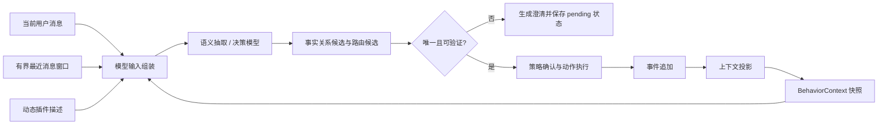

# 实现对齐矩阵

> 本文是当前架构方案的实现证据索引。它只描述仓库中已经存在的通用运行时机制，不把任何具体业务能力写入 IAR 核心。

## 1. 总体运行链路

关键原则：最近消息帮助模型理解语境，但不是可信事实；模型只能在运行时生成的候选和插件描述范围内提出决策；副作用必须经过策略、授权和确认边界。

## 2. 上下文输入

| 输入层 | 内容 | 可信级别 | 代码证据 |
| --- | --- | --- | --- |
| 当前问题 | 本轮用户原文 | 不可信输入 | `examples/agent-sandbox/src/session-routing.ts` |
| 结构化状态 | `BehaviorContext`、`factHistory`、`pendingReference`、澄清状态和工作流状态 | 经 Schema/事件投影校验的运行时状态 | `packages/contracts/src/types-state.ts`、`packages/runtime/src/context-projector.ts` |
| 最近消息 | 按策略读取的有界 `{role,text}` 列表 | 不可信数据，只用于理解上下文 | `examples/agent-sandbox/src/session-core.ts`、`examples/agent-sandbox/src/models/model-input-transport.ts` |
| 能力描述 | 由 `PluginHost.descriptors()` 动态收集的插件描述 | 候选能力描述，不等于授权 | `packages/plugins/src/host/plugin-host.ts`、`examples/agent-sandbox/src/session.ts` |
| 动作结果 | 当前动作的已校验结果 | 仅可作为本轮回复输入，事实仍需事件投影 | `examples/agent-sandbox/src/session-replies.ts` |

语义抽取、Function/Plugin 决策和回复生成均可接收最近消息窗口；上下文压缩明确不接收最近原文，以防原文绕过结构化状态边界。

## 3. 有序可信事实链

`BehaviorContext.factHistory` 保存按 `sequence` 排序的 `records`。每条记录包含动态来源信息（如 `sourceEventId`、`functionId`、`pluginId`）和插件成功输出中声明的有限值。核心不维护业务字段白名单，也不把某个业务 ID 写死在类型或解析器中。

- 成功事实通过事件投影追加，不能覆盖历史记录。
- `focusRecordId` 只表示当前关注记录，不改变历史事实。
- 事实记录的 `recordId` 是通用不透明标识；业务值只能来自插件声明并通过契约校验的输出。
- 历史兼容字段可以保留用于读取旧数据，但新解析路径使用关系、锚点和偏移表达指代，不把业务值直接写入 `references`。

## 4. 自然语言顺序指代

`“上一个”“前一个”“下一个”“第一个”“最后一个”` 等词先由模型表达为通用关系，再由运行时基于有序事实链计算候选：

1. 模型提出 `relation`、可选 `anchorRecordId` 和 `offset`。
2. `resolveFactRelationCandidates` 按序列和锚点计算有限候选。
3. 唯一候选才形成 `resolved` 结果；多个候选形成 `reference_ambiguous`；没有候选形成 `reference_unresolved`。
4. 歧义结果保存 `PendingReference`，下一轮用户选择只收敛到这组候选，不扩大到任意历史事实。
5. 未解析或歧义时不路由、不执行副作用；重复无法回答时由动态插件描述驱动澄清或功能重新选择。

代码证据：`packages/runtime/src/fact-relation.ts`、`examples/agent-sandbox/src/session-routing.ts`、`examples/agent-sandbox/src/session.ts`、`packages/contracts/src/schema-context.ts`。

## 5. 澄清与兜底

澄清状态是运行时状态而不是固定业务话术：

- `clarification` 保存模式、未解析次数、原因和动态选项。
- `pendingReference` 保存本次事实关系消歧的原文、关系、锚点和候选记录 ID。
- 同一问题多次无法解析时，运行时重新读取 `PluginHost.descriptors()`，让模型基于当前插件描述反问用户重新选择可用功能；核心不写死“转人工”或任何功能名。
- 澄清回复不能创建事实、授予能力或触发动作；成功解析后才清理对应 pending 状态。

纯未命中（无 pending 状态）的轮次整轮分流给进程内 Pi Agent 兜底：每会话一个 `pi-agent-core` 实例，IAR 已处理轮次以「【已由业务系统处理】」备注进入 Pi 上下文，Pi 故障（超时/中止/空回复）自动回退上述 IAR 兜底。Pi 不参与路由决策与副作用执行，授权与确认边界不被绕过。此分流只在沙箱网页演示路径启用；对 Pi 宿主的前置集成（`@iar/pi-bridge` 扩展在 Pi `input` hook 中拦截，命中返回 handled、未命中返回 continue、`source=extension` 放行、fail-closed）见主方案 5.5，bridge 会话不挂载进程内委托。

代码证据：`packages/runtime/src/execution/event-log.ts`、`packages/runtime/src/context-projector.ts`、`examples/agent-sandbox/src/session-clarification.ts`、`examples/agent-sandbox/src/session-stream-turn.ts`、`examples/agent-sandbox/src/models/pi-agent-delegate.ts`、`examples/agent-sandbox/src/session-turn-helpers.ts`、`packages/adapters/pi/src/extension.ts`、`examples/agent-sandbox/src/http-pi-bridge-routes.ts`。

## 6. 持久化与恢复

SQLite Provider 持久化事件、结构化快照和会话消息。恢复流程是：

1. 读取并校验指定会话的最新有效结构化快照。
2. 恢复投影状态、事实历史、澄清状态和待确认状态。
3. 按 `recentMessageLimit` 调用 `listMessages(sessionId, { limit })`，重新构造有界最近消息窗口。
4. 下一次模型调用同时得到结构化上下文和最近消息；最近消息不会被合并为可信事实。

代码证据：`examples/agent-sandbox/src/session-core.ts`、`packages/storage/src/spi/types.ts`、`packages/storage/src/sqlite/provider.ts`、`packages/storage/src/sqlite/worker.ts`。

## 7. 压缩边界

上下文压缩只处理结构化上下文和不可变事件，不接收 `recentMessages`。压缩结果必须经过 Schema、来源事件、关键字段和事实来源校验；失败时保留上一份有效状态。压缩不能新增、覆盖可信事实，也不能替代持久化消息表。

代码证据：`examples/agent-sandbox/src/models/model-input-transport.ts`、`examples/agent-sandbox/src/session-compaction.ts`、`packages/runtime/src/compaction-validation.ts`。

## 8. 动态能力边界

核心路由只依赖插件描述接口和候选契约，不维护具体功能目录。插件的 `functionId`、`pluginId`、描述、输入输出契约和能力声明都来自注册表/Manifest；文档中的示例名称仅用于说明协议，不是核心代码中的分支条件。

代码证据：`packages/plugins/src/host/plugin-host.ts`、`packages/plugins/src/sdk`、`examples/agent-sandbox/src/session-routing.ts`。

## 9. 当前状态与文档维护

本矩阵记录的是当前代码事实，不是未来规划。若代码变更了以下任一边界，必须同步更新本矩阵和主方案：

- 模型调用是否接收最近消息窗口；
- 事实历史是否追加、排序和定位；
- 指代关系候选和澄清状态如何保存；
- 插件描述的发现方式；
- 会话快照与消息窗口的恢复顺序；
- 压缩模型的输入和可信边界。
